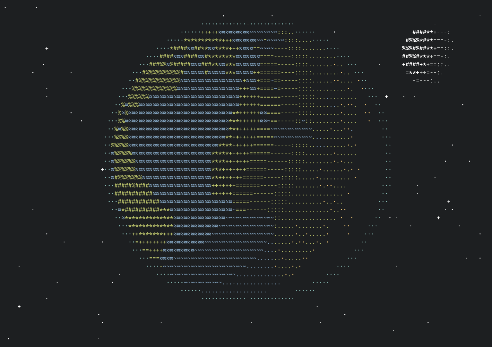

# 12.04.1999



A little terminal screensaver for my birthday — 12 April 1999, which is also Cosmonautics Day,
the anniversary of Gagarin's first flight around the Earth. A spacecraft circles a spinning globe,
the date lights up, and the story loops.

```sh
gcc main.c -o hello -lncursesw -lm && ./hello
```

Press any key to exit. Circles are sized from your terminal's cell shape; if it looks stretched,
pass the cell height/width ratio yourself, e.g. `./hello 2.9`

## Recording

With [asciinema](https://asciinema.org) and [agg](https://github.com/asciinema/agg), in Tomorrow Night colors:

```sh
TERM=xterm asciinema rec --cols 140 --rows 42 -c "timeout --foreground 16.5 ./hello 2.33" raw.cast
# keep one loop, drop the exit
jq -c 'select(type == "object" or (.[0] < 16 and .[1] == "o"))' raw.cast > demo.cast
agg --font-family "JetBrainsMonoNL Nerd Font Mono" --font-size 18 --fps-cap 30 --last-frame-duration 0 \
    --theme 1d1f21,c5c8c6,282a2e,cc6666,b5bd68,f0c674,81a2be,b294bb,8abeb7,c5c8c6,969896,cc6666,b5bd68,f0c674,81a2be,b294bb,8abeb7,ffffff \
    demo.cast demo.gif
```
